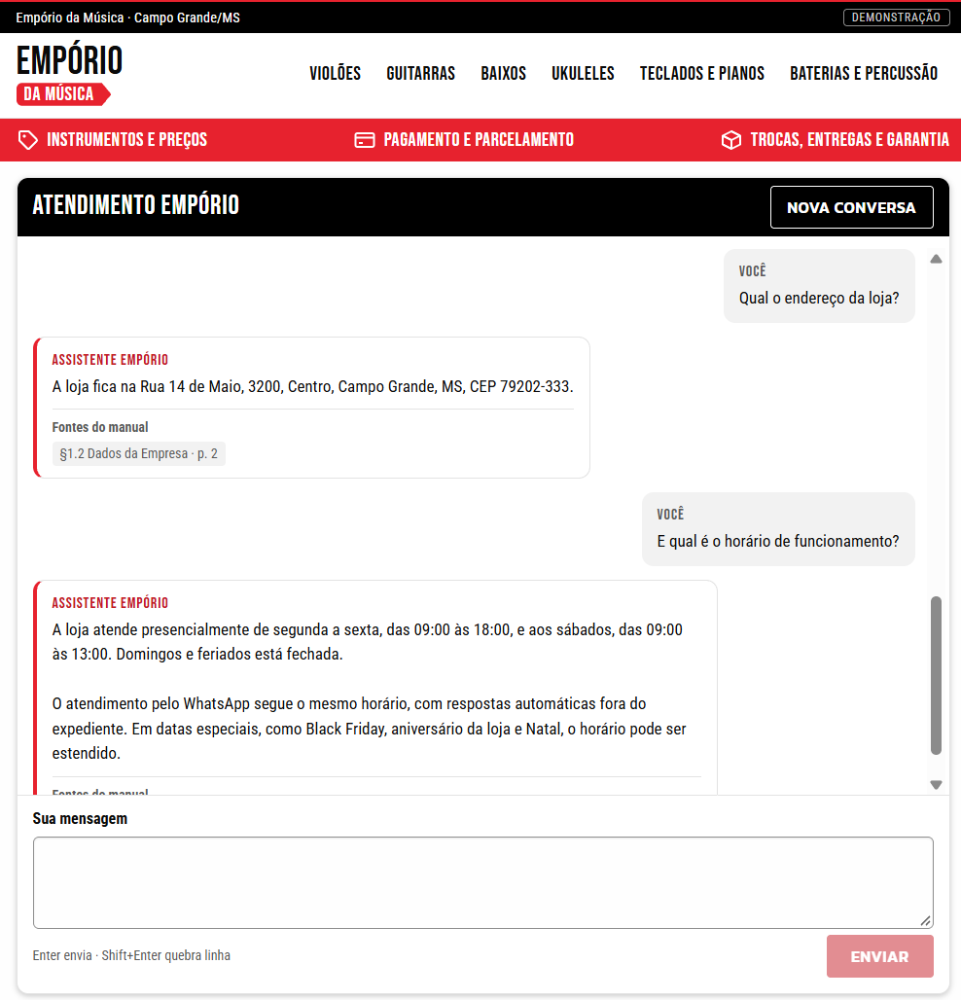

# Empório AI Assistant

Customer-support assistant for **Empório da Música**, a fictional music store, built for the Artefact AI Engineer technical case.

## Goal and scope

Answer repetitive customer questions (products, prices, stock, promotions, payment, returns, exchanges, warranty, shipping, hours, contacts) accurately and in the store's tone, without inventing facts. In scope: a chat UI, a single agent with read-only catalog tools and the store manual, ephemeral conversation memory, and an evaluation harness with a budget ledger. Out of scope for v1: private orders and customer data, purchases, reservations, handoff to a human, WhatsApp, login, deployment.

## Current state (2026-11-03)

- **Implemented and working end to end:** chat UI (React + TypeScript + Vite) -> FastAPI -> one agent -> read-only tools over a local SQLite snapshot of the challenge catalog, with the full store manual in the prompt.
- **Final configuration (frozen at commit `0dc5253`, config `d9f674fcc08d`):** Anthropic Claude Haiku 5.5, the full store manual in the prompt, 5-minute prompt cache, at most 4 model calls per turn.
- **Measured:** real model runs on the 30 **development** scenarios, reviewed by hand (results below): the final configuration passed 27/30 and 28/30 with 0 critical failures in its two runs. Embeddings and BM25 retrieval were measured as alternatives and not selected. On the **reserved validation** (10 cases, run once after the freeze): 9/10, 0 critical failures. This is supporting evidence from small suites, not statistical proof or a production SLA.
- **Evaluated code vs later commits:** the evaluated agent, prompt, tools, limits and configuration are those of commit `0dc5253`. Later commits change only documentation and the browser interface (EMP-20 store-style layout, EMP-21 one-column simplification); `backend/`, `config/`, `evals/` and `scripts/` are unchanged since `0dc5253`. The validation manifest keeps pointing at `0dc5253`.

## Interface



*The final one-column page (EMP-21) during a real (live) conversation, from the manual session in [examples/conversations.md](examples/conversations.md).*

- **Identity:** Empório da Música, the fictional store of the case (Campo Grande/MS, as in its manual). One small "Demonstração" tag marks the page as a demo.
- **Layout (one column):** a compact header with the logo and six instrument shortcuts (only categories that have products), an informative red band (instruments and prices; payment and installments; exchanges, delivery and warranty; titles, not buttons), the chat panel and a one-line footer. There is no header search and no FAQ: the message box is the single way to ask, and the shortcuts send a question about that category through the same chat.
- **Chat panel:** answers are plain text with the cited manual sections listed as sources (no product cards: the API does not return structured products). "Nova conversa" starts a new session. Only the history scrolls, so the message box and the send button are never cut off, including at 200% zoom and on 360 px screens. On a network failure the typed text is kept and can be resent.
- **Conversation limit:** when the server reports the limit (or a lost or expired session), the message box is replaced by "Esta conversa chegou ao limite." and one "Iniciar nova conversa" button; the history stays readable, the typed text is kept for the new conversation, and nothing restarts on its own.
- **Simulated mode:** the backend reports its mode when a session starts; only in simulated mode the page shows the compact notice "Modo simulado · respostas de teste, sem chamada à IA." (expandable for details) and a "Resposta simulada" badge on each reply. In live mode neither appears, and the page never shows the model, configuration or budget.
- **Visual reference:** the look (black, white and red, condensed display type, red information band, rounded panels) was adapted from an audit of the public home page of Pride Music Shop, a real instrument store, chosen only as a visual reference for a music retailer. No name, logo, image, price, contact, policy or benefit of that store is used; all store facts come from the case's catalog and manual. Observed values, accessibility adjustments and our own decisions are recorded in [docs/PRIDE_DESIGN_AUDIT.md](docs/PRIDE_DESIGN_AUDIT.md). Fonts come from Google Fonts; without network the page falls back to system fonts.

## Architecture

```
Browser (frontend/src) --text + request id--> FastAPI (main.py) --> AssistantService (sessions)
   --> Agent (one bounded model/tool loop) --> provider adapter (Anthropic / OpenAI / Ollama / simulated)
                                          \--> tools.call_tool --> read-only SQLite catalog snapshot
```

- **One agent, no framework.** A bounded loop (max model calls, tool calls, time, output and prompt size per turn) is enough for this scope and keeps every limit in code. See [docs/architecture.md](docs/architecture.md).
- **Tools own the facts.** `search_products`, `get_product`, `quote_price`, `list_categories`. Money is computed only in `commerce.py` (Decimal, ROUND_HALF_UP); the model repeats tool values. Details in [docs/tools.md](docs/tools.md).
- **Full manual as policy context.** The whole manual (~8k tokens) with section ids and pages; the answer cites sections and the backend keeps only ids that exist. BM25 and embeddings (`text-embedding-3-small`, top-4 sections) retrieval plug into the same selector contract; both were measured and scored below the full manual on this small manual (below), so they stay as non-default options. Every embedding call goes through the budget ledger.
- **Prompt caching (Anthropic, opt-in).** One explicit 5-minute breakpoint at the end of the stable system prompt (instructions + manual).
- **Ephemeral memory.** History lives in the API process, per session, with limits and a 30-minute idle expiry. Each earlier assistant reply carries a server-written record of the tool calls that really ran in that turn (tool, validated arguments, ok/failed, data generation; no prices or stock).
- **Budget ledger.** Every paid call goes through one guarded path that reserves a worst-case cost, settles only complete provider usage and keeps the reservation when the outcome is unknown.

## Installation and running

Tested only on **Windows 11 with Windows PowerShell 5.1**. Other operating systems are not tested and not claimed. On 2026-11-03 (EMP-15) these steps were checked in a fresh copy of the repository files with a new virtual environment; a clean `git clone` of the published final version is checked separately (see `docs/progress.md`).

Prerequisites:

- Python 3.11 available as `py -3.11`
- Node.js 24 and npm (developed with Node 24.18.0, npm 11.16.0)
- Git
- The case package provided to candidates (CSV tables and the store manual PDF), extracted locally. It is not redistributed in this repository.
- Only for live mode: an Anthropic API key.

No Docker or global packages. Every block below says where to run it; `<repo>` is the folder created by the clone.

### 1. Clone the repository

Any folder you choose:

```powershell
git clone https://github.com/mori-mkm/emporio-ai-assistant.git
Set-Location emporio-ai-assistant
```

### 2. Create the Python environment

From `<repo>`:

```powershell
py -3.11 -m venv .venv
.\.venv\Scripts\python.exe -m pip install -c backend\constraints.txt -e ".\backend[dev]"
```

`backend/pyproject.toml` declares the direct dependencies and `backend/constraints.txt` pins the tested set.

### 3. Install the frontend

From `<repo>`:

```powershell
Set-Location frontend
npm ci
Set-Location ..
```

`frontend/package-lock.json` pins the frontend.

### 4. Prepare the data from the case sources

From `<repo>`. Point `$src` at the extracted case package (quotes matter: the folder name has spaces and accents):

```powershell
$src = 'C:\path\to\Desafio Técnico AI Engineer 2026'
.\.venv\Scripts\python.exe -m emporio_assistant.prepare_data `
    --csv-dir "$src\data" `
    --manual "$src\data\políticas_da_loja.pdf" `
    --output-dir data\derived
```

It validates the CSVs and the manual, publishes a new generation (`catalog.sqlite`, `policies.json`, `quality_report.json`) under `data\derived\generations\` and makes it active (all git-ignored). Customers and orders are not loaded. Exit code 1 means nothing changed. Data rules and source ambiguities: [docs/data.md](docs/data.md).

### 5. Open in simulated mode (no AI call, no cost)

The backend reads **process environment variables** only. `.env.example` is a reference list and is **not loaded** automatically; set variables in the PowerShell window that starts the API.

Terminal 1, API, from `<repo>`. Run **one worker**: sessions live in memory. Clear variables left by a previous live session first: simulated mode refuses `EMPORIO_PROVIDER=anthropic` and the chat then stays disabled.

```powershell
Remove-Item Env:EMPORIO_PROVIDER, Env:EMPORIO_PROMPT_CACHE, Env:EMPORIO_POLICY_CONTEXT -ErrorAction SilentlyContinue
$env:EMPORIO_ASSISTANT_MODE = 'simulated'
.\.venv\Scripts\python.exe -m uvicorn emporio_assistant.main:app --app-dir backend --host 127.0.0.1 --port 8000
```

Terminal 2, web UI, from `<repo>`:

```powershell
Set-Location frontend
npm run dev
```

Open http://127.0.0.1:5173. Vite forwards `/api/*` to the API, so the browser talks to one origin. Simulated replies run the real API, sessions, agent loop and tools, but the model is replaced by a scripted reply; the page marks them as test replies. Not evidence of model quality.

### 6. Configure live mode with Anthropic (paid)

Use a **separate PowerShell window** for the API, not the terminal where Claude Code runs: Claude Code can pick up `ANTHROPIC_API_KEY` from its environment and bill the API instead of using the Pro plan login, so the key must exist only in the API's window.

Once per fresh installation, from `<repo>`, create the live budget ledger:

```powershell
.\.venv\Scripts\python.exe -m emporio_assistant.budget init --mode live
```

The command refuses to overwrite an existing ledger. **Never delete or re-create the ledger** (`data\budget\ledger.sqlite`) to clear a balance, a hold or an error: it is the record of real spending. Inspect it with the read-only `budget summary` and `budget run <run_id>`; `settle` and `clear-hold` are owner actions after checking the provider console.

Terminal 1, API, from `<repo>`. The key is read without echo and removed when you stop the server:

```powershell
$secure = Read-Host 'ANTHROPIC_API_KEY' -AsSecureString
$env:ANTHROPIC_API_KEY = [System.Net.NetworkCredential]::new('', $secure).Password
Remove-Variable secure
Remove-Item Env:EMPORIO_POLICY_CONTEXT -ErrorAction SilentlyContinue
$env:EMPORIO_ASSISTANT_MODE = 'live'
$env:EMPORIO_PROVIDER = 'anthropic'
$env:EMPORIO_PROMPT_CACHE = 'system-5m'
.\.venv\Scripts\python.exe -m uvicorn emporio_assistant.main:app --app-dir backend --host 127.0.0.1 --port 8000
# after stopping the server with Ctrl+C:
Remove-Item Env:ANTHROPIC_API_KEY
```

Terminal 2 is the same as in step 5. This is the final configuration (`live` + `anthropic` + `system-5m` + the default full manual, hash `d9f674fcc08d`). The key never reaches the browser, logs or reports. Prices come from the versioned `config/pricing.json`; every call goes through the ledger and is refused when the budget does not cover its worst case.

All modes (`.env.example` lists every variable):

| `EMPORIO_ASSISTANT_MODE` | Behaviour |
|---|---|
| unset (default) | Chat disabled (503 `assistant_not_configured`); health works. Never a mock or a paid call by default. |
| `simulated` | Offline scripted provider over the real API, sessions, agent loop and tools. |
| `live` | Paid API. `EMPORIO_PROVIDER=anthropic` (default, Claude Haiku 5.5) or `openai` (GPT-6 Luna). Needs the key, verified prices and an existing live ledger. `EMPORIO_PROMPT_CACHE=system-5m` enables the Anthropic cache. `EMPORIO_POLICY_CONTEXT` = `full` (default), `bm25` or `embeddings` (experimental: also the OpenAI key and a prebuilt index). |
| `local` | Ollama `qwen3:8b` on a loopback address, no ledger. Suspended for evaluation (failed a critical scenario). |

### 7. Run the offline checks

From `<repo>`. No network or model calls:

```powershell
$env:PYTHONDONTWRITEBYTECODE = '1'
.\.venv\Scripts\python.exe scripts\verify.py --mode app
```

Runs the harness tests, `ruff check`, `pytest` and the frontend lint, typecheck and build. The pytest suite uses synthetic fixtures and fake provider clients, so it passes without the case data; step 4 is what checks the real sources. With the data prepared, the development scenarios can also be checked against it:

```powershell
.\.venv\Scripts\python.exe -m emporio_assistant.scenarios --scenarios evals\development_scenarios.json --data-dir data\derived
```

Browser flow checks were run locally with headless Edge against the simulated backend (scripts kept outside the repository, see `docs/progress.md`).

Docker is a possible future improvement; it is not implemented.

## Evaluation runs

`python -m emporio_assistant.runner` runs the development scenarios through the same service as the API (`--help` lists the flags). Paid runs need `--executor live --confirm-paid-run --batch-cap-usd <= 0.25`; reports go to the git-ignored `evals/results/`. Method, commands and every reviewed run: [docs/evaluation.md](docs/evaluation.md). A separate `--suite validation` mode runs the reserved cases on the validation budget after a freeze check (run once, result below). `python -m emporio_assistant.retrieval_eval` scores which manual sections a selector retrieves (BM25 offline; `--policy embeddings` makes paid, budget-guarded embedding calls). `python -m emporio_assistant.export` copies 3-5 observed development conversations, unchanged and in the language they ran (Portuguese), into Markdown.

## Example conversations

Full transcripts (Portuguese, as they happened): [examples/conversations.md](examples/conversations.md). It holds five conversations from two sources:

- **Manual browser session:** one real (live) conversation in the final interface, eight customer turns in a single session, transcript provided by the owner. Date, commit and configuration were not recorded for it, so none are claimed. The four screenshots below are parts of this same session, grouped by topic; they are not four separate sessions and not benchmark runs.
- **Development run `939445`** (final configuration, config `d9f674fcc08d`): four conversations exported unchanged by the runner: price + stock + installments across turns, a return under the policy's conditions, installments where the manual's two rules disagree, and purchase/reservation/refund requests the assistant cannot perform.

| Topic (manual session) | Screenshot |
|---|---|
| Catalog and recommendations | [01-catalog.png](examples/screenshots/01-catalog.png) |
| Store address and opening hours | [02-store-information.png](examples/screenshots/02-store-information.png) |
| Product price and installments | [03-price-installments.png](examples/screenshots/03-price-installments.png) |
| Returns policy | [04-returns.png](examples/screenshots/04-returns.png) |

## Development results (30 development scenarios)

All runs used the same tools, data generation and limits (4 model calls and 8 tool calls per turn), reviewed by hand with one strict reading. One to three runs per configuration on known development scenarios: observed differences, no statistical claim.

| Configuration | Prompt | Run | Pass | Critical failures | Cost | Run time |
|---|---|---|---|---|---|---|
| Haiku 5.5, full manual, no cache (`0b5879238a78`) | previous | | 26/30 | 0 | US$0.0956 | 191 s |
| Haiku 5.5, full manual, 5-min cache (`14a0f85d715d`) | previous | | 26/30 | 0 | US$0.0280 | 182 s |
| Haiku 5.5, BM25 top-4 sections (`7f757562976b`) | previous | | 21/30 | 1 | US$0.0547 | 190 s |
| GPT-6 Luna, full manual (`61a77ba13d48`) | previous | | 15/30 | 0 | US$0.0106 | 202 s |
| Haiku 5.5, embeddings top-4, no cache (`7100cd7f80f5`) | revision 2 | `47015b` | 25/30 | 0 | US$0.0606 | 213 s |
| Haiku 5.5, BM25 top-4, no cache (`6fad0d2d49cc`) | revision 2 | `3b0b67` | 24/30 | 1 | US$0.0589 | 206 s |
| Haiku 5.5, full manual, no cache (`30baf5c5f663`) | revision 2 | `cc296f` | 28/30 | 0 | US$0.1074 | 204 s |
| **Final:** Haiku 5.5, full manual, 5-min cache (`d9f674fcc08d`) | revision 2 | `d86dfc` | 27/30 | 0 | US$0.0304 | 194 s |
| **Final** (repeat) | revision 2 | `939445` | 28/30 | 0 | US$0.0311 | 199 s |

"Revision 2" is the current instructions plus server-written lookup records, measured together. The three cache-off revision-2 runs are the controlled retrieval comparison. Embeddings reduced the policy context to four sections but missed sections an answer needed (contacts, delivery times; English retrieval 1/3) and once stated contact data that is not in the manual. BM25 was the cheapest of these runs but told a customer to disregard true exchange exclusions (critical). The full manual gave the best observed quality. With the cache, one call writes the ~8.6k-token prompt prefix and every later call reads it, which cut the cost of the full manual by about 71% with no observed quality change. Full manual + 5-minute cache was therefore selected for this small, static manual. Known non-critical gaps: the metro delivery time (DEV-016) and the tracking-code format (DEV-030). Details: [docs/evaluation.md](docs/evaluation.md).

## Reserved validation (10 cases, run once)

The final configuration was frozen (commit, config hash, data hashes, rubric hash and validation file hash in a manifest) and run once on 10 reserved cases on a separate budget: 10/10 cases and 21/21 customer turns executed, no divergence from the freeze, **9/10 passed, 0 critical failures**, US$0.0144, 94 s. The one failure (VAL-008) correctly handled a damaged delivery and the order-lookup boundary but omitted the manual's transport-insurance statement; it stays a known limitation and nothing was tuned afterwards.

Limitation: the reserved cases were written by the AI coding assistant after the configuration was selected, with knowledge of the project (not blind, not independent), and graded by the same reviewer. They were frozen before the run and the candidate was not changed after it. 9/10 on a small suite is supporting evidence, not proof of correctness or a production SLA.

## Code controls vs requested behaviour

| Enforced by code | Asked of the model (measured by runs, not guaranteed) |
|---|---|
| Tool allowlist, strict arguments, read-only SQL, no private data or write tools | Using tools for every price, stock and payment statement |
| Money computed in `commerce.py`; citations filtered to existing sections | Repeating tool values; citing the right sections |
| Call, tool, time, output, prompt and history limits; no retries; no fallback model | Answering what was asked; offering alternatives |
| Sessions, isolation, request-id dedup, data-generation pinning, lookup records written by the server | Not inventing orders, reservations, refunds or handoff |
| Budget gate on every paid call; sanitized errors | Tone, scope, ignoring instructions found in data |

## Known limitations

- The catalog is a static snapshot of the challenge files, not live inventory; "available" means available in the catalog records. Querying the local SQLite snapshot during a conversation is not an integration with a stock system.
- Sessions are in memory: one worker, 30-minute idle expiry, 12 exchanges; nothing survives a restart. The lookup records are kept only for answered turns: a turn stopped by a limit leaves none, so a missing record does not prove that no lookup was attempted.
- This is a prototype evaluated on development scenarios, not a production customer-service system.
- The manual contradicts itself (two phone/WhatsApp numbers, two e-mail spellings, two installment rules); the assistant reports the divergence instead of choosing.
- No customer or order data, purchases, reservations or handoff; no authentication or deployment; the Vite proxy is for local development only.
- The ledger controls only application calls that go through it, not other spending on the provider accounts.
- Quality numbers come from 30 known development scenarios (one to three runs per configuration) and 10 reserved cases run once, authored after the configuration was selected; known non-critical gaps: metro delivery time, tracking-code format, transport insurance on a damaged delivery.
- Prompt caching saves cost only when calls arrive within 5 minutes of each other (true in a batch, not guaranteed for sparse chat traffic).

## AI assistance

This project is planned and developed with AI assistance. ChatGPT helped plan the case, the work breakdown and the development harness. Claude Code (Anthropic) helps implement, test and review the code and documents under the owner's direction; at the owner's request it also wrote the 10 reserved validation cases and the hand reviews of the evaluation runs. The owner reviews every change, decides and makes all commits.
