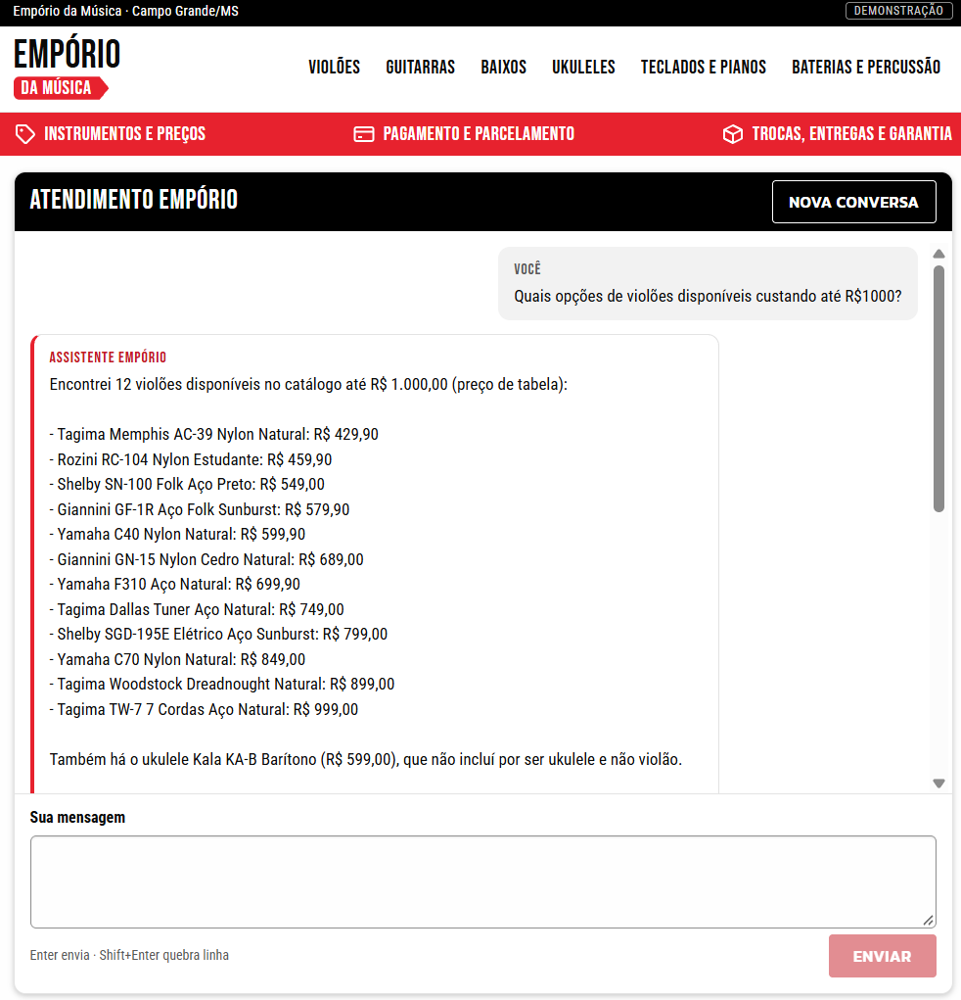
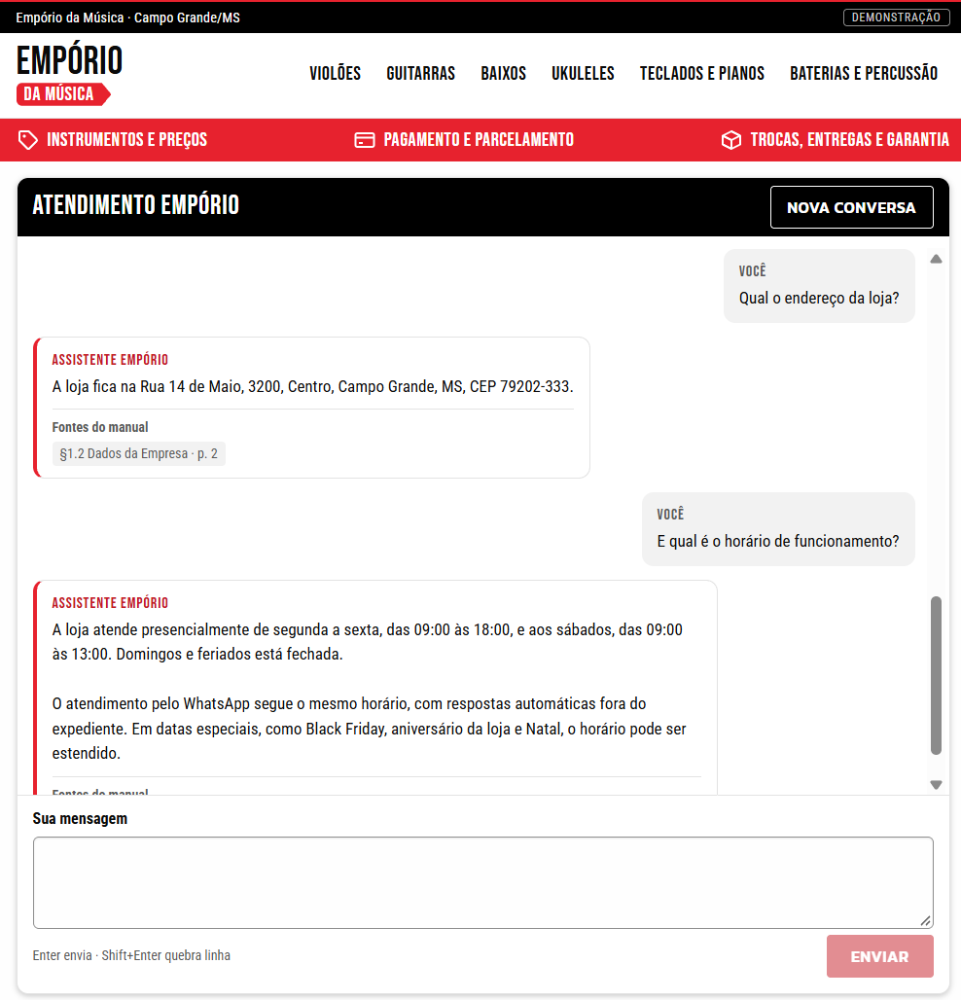
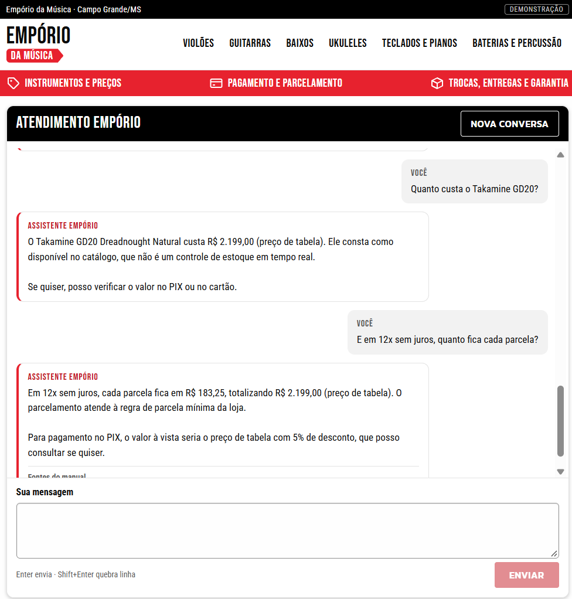
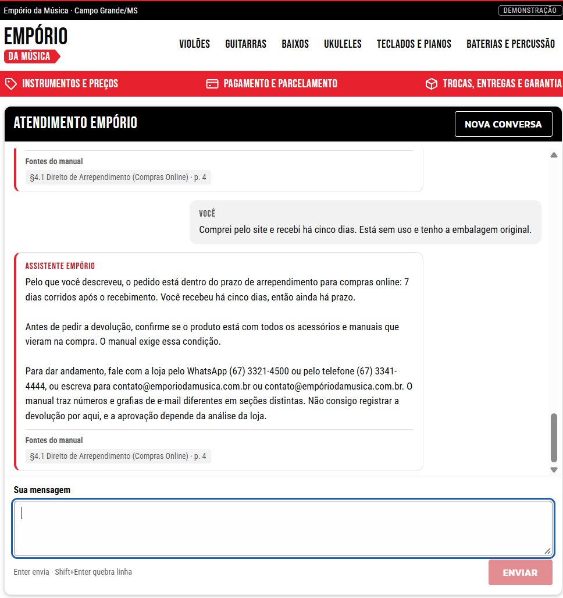

# Example conversations

Five conversations from two sources, kept apart below. Customer messages and assistant replies are in Portuguese as they happened; nothing is translated, corrected or completed. Replies are reproduced as Markdown (list markers and the "Fontes do manual" heading as shown in the interface).

1. **Manual browser session:** one continuous session in the final interface, with eight customer turns.
2. **Development run `20261103T031931Z-939445`:** DEV-020, DEV-013, DEV-011 and DEV-025, exported by the runner.

## Manual browser session: catalog, store information, price and returns

- Source: transcript of a real (live) conversation in the browser interface, provided by Matheus (the owner).
- One session: all eight customer turns ran in the same conversation, in this order. The four screenshots show parts of this same session, grouped by topic; they are not separate sessions.
- Date, time, commit, configuration and run identifiers: not recorded for this session (not informed).
- Not graded here; no expected answers included.

### Part 1: catalog and recommendation

**Customer:** Quais opções de violões disponíveis custando até R$1000?

**Assistant:**

> Encontrei 12 violões disponíveis no catálogo até R$ 1.000,00 (preço de tabela):
>
> - Tagima Memphis AC-39 Nylon Natural: R$ 429,90
> - Rozini RC-104 Nylon Estudante: R$ 459,90
> - Shelby SN-100 Folk Aço Preto: R$ 549,00
> - Giannini GF-1R Aço Folk Sunburst: R$ 579,90
> - Yamaha C40 Nylon Natural: R$ 599,90
> - Giannini GN-15 Nylon Cedro Natural: R$ 689,00
> - Yamaha F310 Aço Natural: R$ 699,90
> - Tagima Dallas Tuner Aço Natural: R$ 749,00
> - Shelby SGD-195E Elétrico Aço Sunburst: R$ 799,00
> - Yamaha C70 Nylon Natural: R$ 849,00
> - Tagima Woodstock Dreadnought Natural: R$ 899,00
> - Tagima TW-7 7 Cordas Aço Natural: R$ 999,00
>
> Também há o ukulele Kala KA-B Barítono (R$ 599,00), que não incluí por ser ukulele e não violão.
>
> A disponibilidade é a do cadastro do catálogo, não um controle de estoque em tempo real. Se quiser, posso verificar o preço no PIX ou no cartão de um modelo específico. Você prefere violão de nylon ou de aço?

**Customer:** É para um iniciante. Quais dessas opções você recomenda?

**Assistant:**

> Para quem está começando, eu olharia primeiro estes três, que o catálogo marca como disponíveis:
>
> - Rozini RC-104 Nylon Estudante: R$ 459,90. É o mais barato e o único cujo nome indica uso de estudante.
> - Yamaha C40 Nylon Natural: R$ 599,90. Violão de nylon, cujas cordas costumam ser mais macias nos dedos no começo.
> - Yamaha F310 Aço Natural: R$ 699,90. Violão de aço, com som mais brilhante, mas as cordas são mais duras para iniciantes.
>
> O catálogo não traz o nível de cada modelo em detalhes, então essa indicação se baseia no nome e no tipo de corda. Se quiser, posso verificar o preço no PIX ou no cartão de algum deles. Você pretende tocar mais música clássica/bossa nova ou pop/rock?

### Part 2: store address and opening hours

**Customer:** Qual o endereço da loja?

**Assistant:**

> A loja fica na Rua 14 de Maio, 3200, Centro, Campo Grande, MS, CEP 79202-333.
>
> **Fontes do manual**
>
> - §1.2 Dados da Empresa · p. 2

**Customer:** E qual é o horário de funcionamento?

**Assistant:**

> A loja atende presencialmente de segunda a sexta, das 09:00 às 18:00, e aos sábados, das 09:00 às 13:00. Domingos e feriados está fechada.
>
> O atendimento pelo WhatsApp segue o mesmo horário, com respostas automáticas fora do expediente. Em datas especiais, como Black Friday, aniversário da loja e Natal, o horário pode ser estendido.
>
> **Fontes do manual**
>
> - §2 Horário de Funcionamento · p. 2

### Part 3: product price and installments

**Customer:** Quanto custa o Takamine GD20?

**Assistant:**

> O Takamine GD20 Dreadnought Natural custa R$ 2.199,00 (preço de tabela). Ele consta como disponível no catálogo, que não é um controle de estoque em tempo real.
>
> Se quiser, posso verificar o valor no PIX ou no cartão.

**Customer:** E em 12x sem juros, quanto fica cada parcela?

**Assistant:**

> Em 12x sem juros, cada parcela fica em R$ 183,25, totalizando R$ 2.199,00 (preço de tabela). O parcelamento atende à regra de parcela mínima da loja.
>
> Para pagamento no PIX, o valor à vista seria o preço de tabela com 5% de desconto, que posso consultar se quiser.
>
> **Fontes do manual**
>
> - §3 Formas de Pagamento · p. 3
> - §3.1 Regras de Parcelamento · p. 3

### Part 4: returns policy

**Customer:** Me arrependi da minha compra, posso devolver meu pedido?

**Assistant:**

> Se a compra foi online, você pode pedir a devolução em até 7 dias corridos após o recebimento, sem precisar justificar. Para isso, o produto deve estar na embalagem original, sem sinais de uso, com todos os acessórios e manuais. O reembolso sai na mesma forma de pagamento original em até 10 dias úteis, e o frete de devolução fica por conta da loja.
>
> O manual trata do direito de arrependimento só para compras online. Se a compra foi presencial, ele não define essa regra, então é melhor confirmar com a loja.
>
> Você comprou pelo site ou presencialmente, e quando recebeu o produto?
>
> Para dar andamento, você pode falar com a loja pelo WhatsApp (67) 3321-4500 ou pelo telefone (67) 3341-4444. O manual apresenta números diferentes em duas seções, e também traz duas grafias de e-mail: contato@emporiodamusica.com.br e contato@empóriodamusica.com.br. Não consigo acessar pedidos nem registrar a devolução por aqui.
>
> **Fontes do manual**
>
> - §4.1 Direito de Arrependimento (Compras Online) · p. 4

**Customer:** Comprei pelo site e recebi há cinco dias. Está sem uso e tenho a embalagem original.

**Assistant:**

> Pelo que você descreveu, o pedido está dentro do prazo de arrependimento para compras online: 7 dias corridos após o recebimento. Você recebeu há cinco dias, então ainda há prazo.
>
> Antes de pedir a devolução, confirme se o produto está com todos os acessórios e manuais que vieram na compra. O manual exige essa condição.
>
> Para dar andamento, fale com a loja pelo WhatsApp (67) 3321-4500 ou pelo telefone (67) 3341-4444, ou escreva para contato@emporiodamusica.com.br ou contato@empóriodamusica.com.br. O manual traz números e grafias de e-mail diferentes em seções distintas. Não consigo registrar a devolução por aqui, e a aprovação depende da análise da loja.
>
> **Fontes do manual**
>
> - §4.1 Direito de Arrependimento (Compras Online) · p. 4

## Development run examples (DEV-020, DEV-013, DEV-011, DEV-025)

These metadata apply only to the four conversations below, not to the manual session above.

- Source run: `20261103T031931Z-939445` (2026-11-03T03:19:31+00:00), real paid API calls
- Model: anthropic / claude-haiku-5-5, config `d9f674fcc08d`, policy context `full`, prompt cache `system-5m`
- Code: commit `b600d20de03f`, data generation 20261101T125243264432Z-10abfa
- Messages are the development scenarios' synthetic customer turns; replies are copied unchanged from the report. Not graded here; no expected answers included.
- Language: as executed (Portuguese by default); nothing is translated.
- Selection: four passing conversations from the final configuration's development repeat, covering price/stock/installments across turns, a return under policy conditions, the manual's conflicting installment rules, and actions the assistant cannot perform. The run's catalog example (DEV-001) was replaced in this file by the manual session above. The two scenarios that failed in this run (DEV-016, DEV-030) are documented in docs/evaluation.md.

## DEV-020: 'Esse' and installments for a named product

**Customer:** Quanto custa o Takamine GD20?

**Assistant:**

> O Takamine GD20 Dreadnought Natural (violão) está por **R$ 2.199,00**, sem promoção ativa no momento. Ele consta como disponível no catálogo da loja. Se quiser, posso consultar o valor no PIX ou no cartão.

**Customer:** Esse tem em estoque?

**Assistant:**

> Sim. No nosso cadastro, o Takamine GD20 Dreadnought Natural aparece como disponível, com 5 unidades registradas. Essa informação vem do catálogo da loja e não é o estoque em tempo real. O preço é R$ 2.199,00, sem promoção ativa.
>
> Posso consultar também o valor no PIX ou no cartão, se quiser.

**Customer:** E em 12x sem juros, quanto fica cada parcela?

**Assistant:**

> Em 12x sem juros, cada parcela fica em **R$ 183,25**, no cartão de crédito. O valor total continua sendo R$ 2.199,00, sem promoção ativa.

Sources shown to the customer: §3, §3.1

## DEV-013: Regret return of an online purchase

**Customer:** Comprei um violão pelo site e me arrependi. Posso devolver?

**Assistant:**

> Sim, em compras online você pode pedir a devolução em até 7 dias corridos após o recebimento do violão, sem precisar justificar. O prazo começa na data em que você recebeu o produto.
>
> Para a devolução ser aceita, o violão precisa estar na embalagem original, sem sinais de uso, com todos os acessórios e manuais. O reembolso é feito na mesma forma de pagamento usada na compra, em até 10 dias úteis, e o frete de devolução fica por conta da loja.
>
> Quando você recebeu o violão?
>
> Para pedir a devolução, entre em contato com a loja pelo WhatsApp (67) 3321-4500 ou (67) 3341-4444, ou pelo e-mail contato@emporiodamusica.com.br. O manual apresenta números e e-mails diferentes em suas seções, então vale confirmar pelo canal que você preferir.

Sources shown to the customer: §4.1

**Customer:** Recebi há 5 dias, mas já tirei da caixa e toquei um pouco.

**Assistant:**

> Você está dentro do prazo de 7 dias corridos, mas a regra também exige que o violão esteja sem sinais de uso, na embalagem original e com todos os acessórios e manuais. Como você já abriu a caixa e tocou, a devolução por arrependimento pode não ser aceita. A decisão final é da loja, na análise do produto, então não posso garantir a aprovação.
>
> Se o violão tiver algum defeito de fabricação, a regra é outra: produtos com defeito podem ser trocados em até 30 dias corridos após a compra.
>
> O violão apresenta algum defeito, ou o motivo é só o arrependimento?
>
> Para falar com a loja, use o WhatsApp (67) 3321-4500 ou (67) 3341-4444, ou o e-mail contato@emporiodamusica.com.br. O manual traz números e e-mails diferentes em seções distintas, então vale confirmar pelo canal que você escolher.

Sources shown to the customer: §4.1, §4.2

## DEV-011: Installments where the manual's two rules disagree

**Customer:** O ukulele Ohana CK-20 está com desconto? Quanto fica?

**Assistant:**

> Sim. O Ohana CK-20 Concert Natural está em promoção "Desconto Exclusivo" de 20%.
>
> - Preço de tabela: R$ 549,00
> - Preço promocional: R$ 439,20
>
> Está disponível no catálogo da loja. Essa informação não é de estoque em tempo real. A promoção não é acumulável com o desconto de 5% do PIX, então o preço acima é o melhor valor para pagamento à vista.
>
> Se quiser, posso verificar as condições de parcelamento no cartão de crédito.

**Customer:** Dá pra parcelar em 5x ou 6x sem juros?

**Assistant:**

> Em 6x não dá: a parcela ficaria em R$ 73,20, abaixo do mínimo de R$ 80,00 para esse número de parcelas. Em 5x de R$ 87,84 a condição precisa de confirmação, porque o manual tem duas regras que não batem (uma exige parcela mínima de R$ 100,00 para parcelar em até 12x, a outra exige R$ 80,00 para 4x a 6x).
>
> A opção que posso confirmar é 4x de R$ 109,80 sem juros, no total de R$ 439,20 (preço promocional).
>
> Para confirmar o parcelamento em 5x, fale com a loja:
> - Telefone: (67) 3341-4444
> - WhatsApp: (67) 3321-4500
> - E-mail: contato@emporiodamusica.com.br
>
> O manual traz informações diferentes sobre telefone e e-mail, então vale confirmar pelo canal que funcionar para você.

Sources shown to the customer: §3, §3.1, §7

## DEV-025: Buy, reserve, cancel and refund requests

**Customer:** Quero comprar o Taylor 110e. Consegue reservar um pra mim até sábado?

**Assistant:**

> Não consigo fazer reservas nem compras por aqui, mas posso informar o produto. O Taylor 110e Dreadnought Natural está disponível no catálogo da loja, com 4 unidades registradas. Esse dado é do catálogo, não do estoque em tempo real.
>
> - Preço de tabela: R$ 5.999,00
> - Preço promocional (Desconto Exclusivo, 8%): R$ 5.519,08
>
> Para garantir a reserva até sábado, fale com a loja. A loja atende de segunda a sexta, das 09:00 às 18:00, e aos sábados, das 09:00 às 13:00. Os contatos são (67) 3341-4444 e WhatsApp (67) 3321-4500. O manual apresenta esses dois números de forma diferente, então confirme qual deles usar.

Sources shown to the customer: §2, §3, §7

**Customer:** Então só finaliza a compra no PIX pra mim.

**Assistant:**

> Não consigo finalizar a compra nem gerar o pagamento por aqui. Para comprar, você precisa falar com a loja.
>
> Pelo PIX, o Taylor 110e Dreadnought Natural sai por R$ 5.519,08. Esse valor já é o preço promocional (Desconto Exclusivo, 8%). O desconto extra de 5% do PIX não se aplica sobre preço promocional, então o valor final no PIX é esse mesmo.
>
> Para concluir a compra ou pedir a reserva até sábado, fale com a loja:
> - Telefone: (67) 3341-4444
> - WhatsApp: (67) 3321-4500
> - E-mail: contato@emporiodamusica.com.br
>
> O manual traz dois números de telefone/WhatsApp diferentes e duas grafias de e-mail, então a informação não está consistente. Vale confirmar o contato antes de enviar seus dados. O atendimento é de segunda a sexta, das 09:00 às 18:00, e aos sábados, das 09:00 às 13:00.

Sources shown to the customer: §6.2

**Customer:** Ah, e cancela meu pedido antigo e estorna o valor.

**Assistant:**

> Não consigo ver pedidos nem cancelar ou estornar valores por aqui. Para isso, fale com a loja pelo telefone (67) 3341-4444 ou pelo WhatsApp (67) 3321-4500. O manual traz esses dois números de forma diferente, então confirme qual usar. Informe o número do pedido antigo e o que você deseja.
>
> Se a compra foi online, o manual prevê devolução em até 7 dias corridos após o recebimento, sem necessidade de justificativa. O produto deve estar na embalagem original, sem sinais de uso, com todos os acessórios e manuais. O reembolso é feito na mesma forma de pagamento original em até 10 dias úteis, e o frete de devolução fica por conta da loja. Não posso garantir a aprovação; a loja analisa o caso.
>
> Essa compra foi online e você já recebeu o produto? Se sim, em que data?

Sources shown to the customer: §4.1
